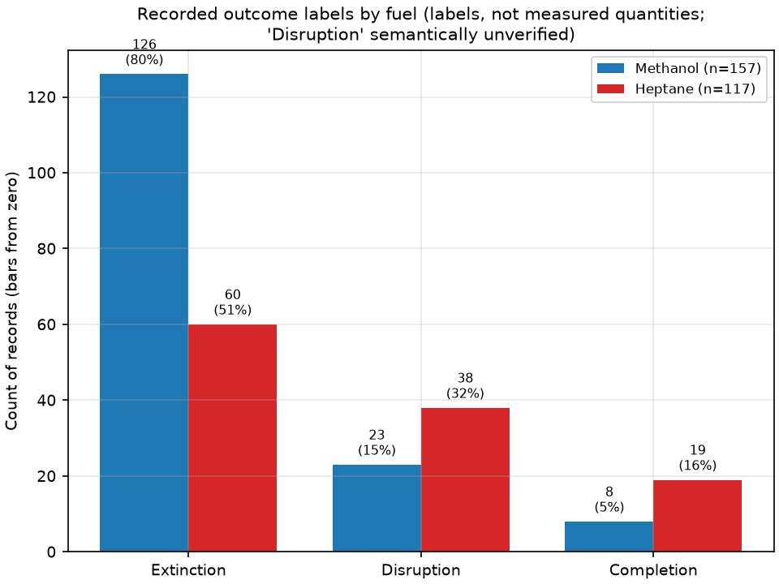
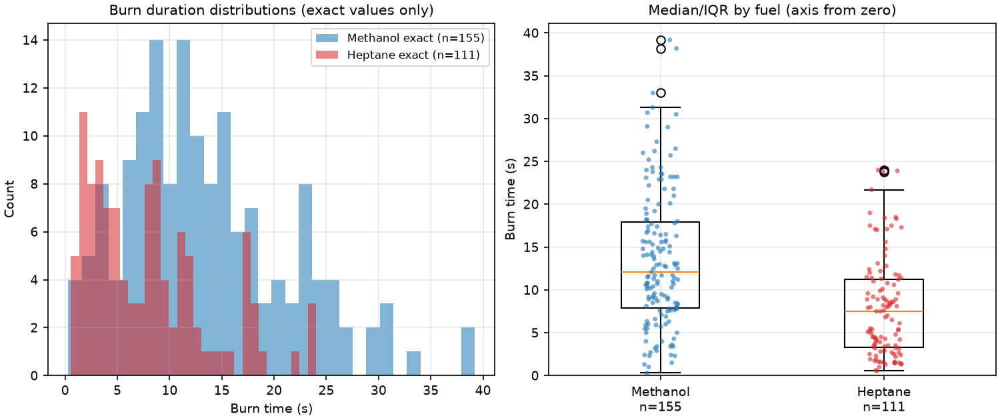
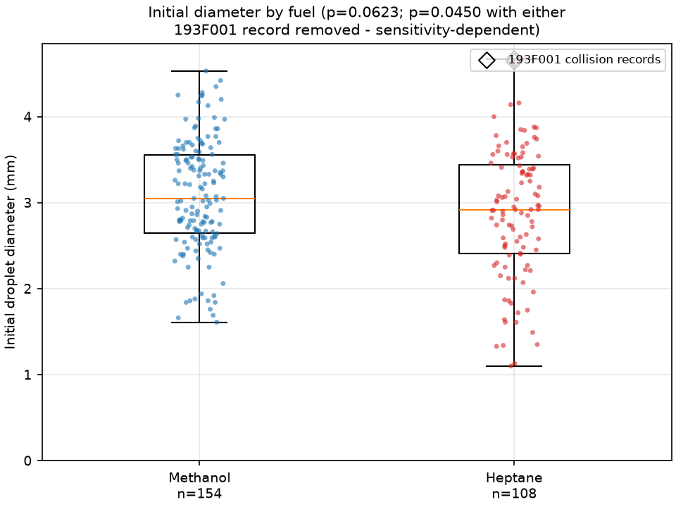
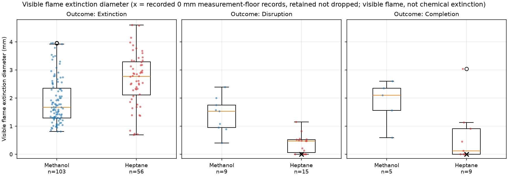
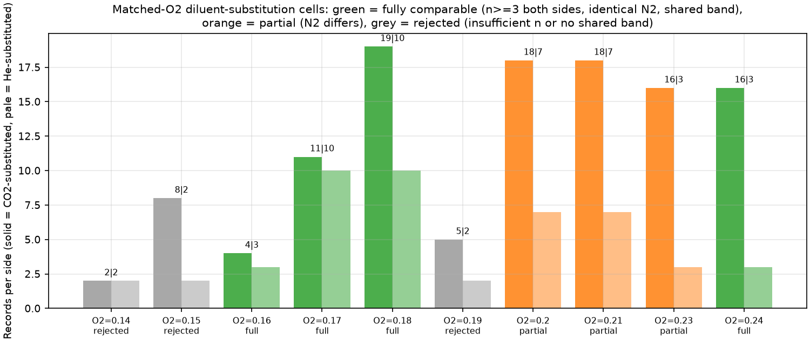
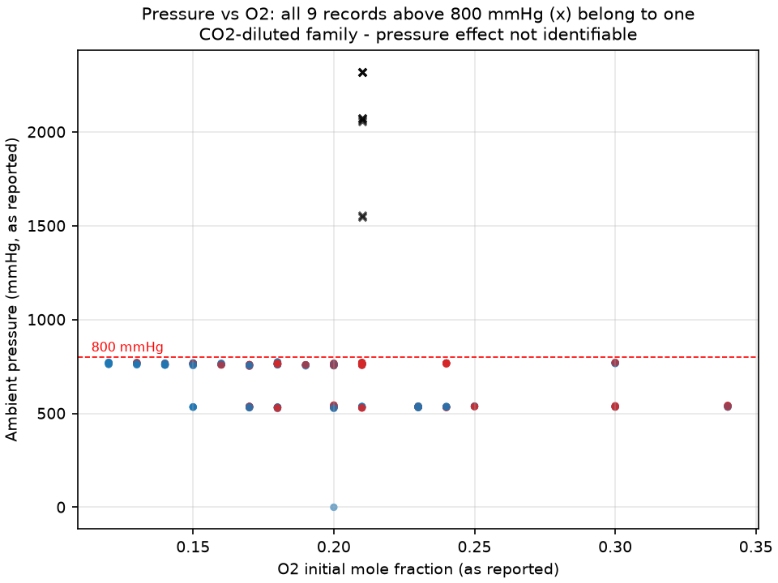

## 0. Title and abstract Between Methanol and n-Heptane in the FLEX-PSI69 Droplet-Combustion Records: A Comparative Analysis With Explicit Limitations

**Analysis unit:** microgravity droplet combustion (NASA Flame Extinguishment Experiment, FLEX; PSI-69)
**Data:** 274 experimental records, March 2009 – December 2011 (Methanol 157, Heptane 117)
**Analysis phases:** dataset audit → exploratory analysis → scientific validation → evidence resolution → comparative analysis (all outputs frozen and hash-verified)

---

## Abstract

The FLEX-PSI69 experimental table records 274 droplet-combustion tests flown
on the International Space Station — 157 with methanol and 117 with n-heptane
("Heptane") — spanning March 2009 to December 2011. This paper reports a
comparative analysis of the recordable quantities — documented outcome
labels, burn duration, initial droplet diameter, visible flame extinction
diameter, and ambient conditions — and states explicitly which comparisons the
data support and which they do not. Three findings are supported as
descriptive differences: recorded outcome-label composition (Extinction
80.3% of methanol records vs 51.3% of heptane records; Freeman–Halton exact
test p = 1.75×10⁻⁶, Cramér's V = 0.3099), burn duration (medians 12.10 s vs
7.50 s; Mann–Whitney U = 4838, p = 1.17×10⁻⁹ by asymptotic approximation,
5×10⁻⁶ by Monte Carlo permutation; rank-biserial r = 0.438; heptane-minus-
methanol median difference −4.6 s, 95% bootstrap CI −7.8 to −2.9), and — with
a stated caveat — nothing in initial droplet diameter, whose fuel contrast is
sensitive to the handling of a duplicated identifier (p = 0.0623 as reported;
p = 0.0450 with either colliding record removed; p = 0.123 with anomalous
records screened). Visible flame extinction diameter is reported for 197 of
274 records, with 77 missing and eight recorded 0 mm values retained as
measurement-floor candidates rather than physical zeros. Of ten
oxygen-matched CO₂/He diluent-substitution cells, only four are fully
comparable on the documented criteria; all nine records above 800 mmHg belong
to a single CO₂-diluted family, so no independent pressure effect is
identified. A recorded burning-rate column contains 258 values but its
definition and unit are unresolved in all available documentation, and the
d²-law-constant reading is contradicted by the data itself; it is therefore
reported as an unresolved scalar without physical interpretation. Finally,
experimental independence is not established — the documented limiting-oxygen-
index procedure is sequential and adaptive, records cluster into 81 series,
and one identifier is duplicated — so every p-value in this paper is
conditional on an assumption the design does not establish. No causal,
mechanistic, or extrapolative physical claim is made.

**Keywords:** droplet combustion; microgravity; flame extinguishment; methanol;
n-heptane; limiting oxygen index; dilution; comparative analysis; missing data;
sensitivity analysis; open data

---

## 1. Introduction

Droplet combustion in microgravity isolates the diffusive burning regime that
buoyancy otherwise dominates, and is the reference geometry for fire-safety
assessment of spacecraft atmospheres. The NASA Flame Extinguishment Experiment
(FLEX) burned single droplets of methanol (non-sooting) and n-heptane (sooting)
in oxygen/inert mixtures aboard the International Space Station's Multi-user
Droplet Combustion Apparatus (MDCA), with the stated mission of mapping
flammability limits and quantifying suppressant efficacy of CO₂, He, and other
diluents [R2, R3, R6]. The experiment's publicly released experimental table
(study PSI-69 [R1]) tabulates, per test, the fuel, nominal ambient pressure
and initial mole fractions, initial droplet diameter, a visible flame
extinction diameter, a burning-rate value, a burn duration, and a recorded
end-of-test outcome label.

Most published FLEX analyses are model- or image-based and present
image-derived diameter time series, soot behaviour, and flame structure
[R7–R9]. The public experimental table, by contrast, contains one reduced
scalar per measured quantity and no reduction metadata; its columns are not
self-describing, and the documentation available to us does not define them
[P3, P3.5]. Comparisons drawn from this table are therefore frequently quoted
without their evidentiary caveats.

This paper asks a deliberately narrow question: **which measurable
differences between methanol and n-heptane are supported by the FLEX-PSI69
records, and how strong are those comparisons?** We answer it by (i) auditing
and validating the table before use, (ii) comparing only quantities whose
definitions are adequate, (iii) reporting effect sizes, uncertainty
intervals, and sensitivity analyses alongside p-values, and (iv) documenting
every comparison the data cannot support. No physical modelling is attempted.

## 2. Research objectives

1. Quantify how recorded outcome-label composition differs between fuels,
   with exact counts, denominators, and multiplicity control.
2. Compare burn-duration distributions with effect size and uncertainty, and
   state the direction of the difference explicitly.
3. Compare initial droplet diameters, propagating the documented
   identifier-collision sensitivity rather than resolving it by choice.
4. Characterise the visible flame extinction diameter record, separating
   missing values, recorded zeros, and positive measurements.
5. Establish which ambient-condition (oxygen/diluent) contrasts are
   legitimately comparable, and which are confounded.
6. Describe the pressure distribution without claiming an identifiable
   pressure effect.
7. State every limitation that qualifies the above, including the
   unestablished independence of the 274 records.

## 3. Dataset and experimental background

**Source.** The PSI-69 Flame Extinguishment Experiment data release
[study DOI 10.60555/mbq8-0451; platform ISS; hardware Combustion Integrated
Rack — Fluids and Combustion Facility / MDCA; NASA Glenn Research Center as
managing centre; grant NNX09AM33A [R1]]. The analysed table holds 274 test
records: Methanol 157, Heptane 117; test dates 5 March 2009 to 8 December
2011; nominal pressures 528–2320 mmHg; initial O₂ mole fractions 0.12–0.34;
N₂, CO₂, and He as the inert components.

**Method as documented** [R2–R4]: droplets of 1.5–6 mm dispensed onto (or
deposited near) a <100 µm silicon-carbide support fiber, ignited by hot wire
after deployment-induced oscillations damped; chamber gases 0.5–3 atm with O₂
0.1–0.4 (initial-charge tolerance ±0.005 mole fraction), pressure tolerance
±0.05 atm maintained within ±10% during a test, ambient temperature 18–27 °C
(tolerance ±0.5 °C), humidity <10% RH, required microgravity <10⁻⁴ m/s².
Droplet size is obtained from back-lit imaging (resolution requirement 30 µm;
≥30 frames/s), whose "time evolution … yields the droplet burning rate … and
extinction droplet size" [R2, §4.3]. Test outcomes were assigned under a
sequential limiting-oxygen-index (LOI) procedure that adapts conditions to
prior results [R3, §5.3].

**Recorded quantities per test:** `FLEX Test #`, `FLEX Identifier`,
`Test Date`, `Test GMT`, `Fuel`, `Ambient pressure (mmHg)`, `O/N/CO/He
initial mole fractions`, `Droplet initial diameter (mm)`, `Visible flame
extinction diameter (mm)`, `Burning rate (mm)` — **unit unresolved**, see §5.5
— `Burn time (s)`, and `Test end ∈ {Extinction, Disruption, Completion}`.

## 4. Data preparation and quality control

The table was audited before any analysis [P1]: the file is Windows-1252
encoded; 34 fields carry a `0x96` (en-dash) artifact byte used as a blank
marker and are treated as missing; two burn times carry a `~` approximation
marker (6 s, 9 s) and are excluded from statistics but reported verbatim.
Missingness by variable: initial diameter 12, extinction diameter 77, burn
time 6, burning rate 16; conditions and labels complete (274). Flagged
records are retained everywhere with explicit flags, and every statistic is
additionally reported in a "screened" variant that excludes
value-integrity-flagged records (one 0 mmHg pressure record, eight 0 mm
extinction diameters, one extinction diameter exceeding initial diameter by
0.01 mm — within the documented 30 µm imaging resolution).

The second, higher-priority step was evidence validation [P3, P3.5]: the
burning-rate column's definition could not be located in any available
document (the EIRD discusses image-derived burning rates and the d²-law
constant class of quantity in mm²/s only as requirements/literature context);
the outcome label "Disruption" is undefined in all six inspected documents;
per-run temperature, gravity, and fiber usage are available only for the 8 of
274 runs with linked telemetry; the telemetry clock domains are unreconciled;
and no calibration records exist locally. These findings constrain every
comparison below and are cited where they bind.

## 5. Statistical methodology

**Populations.** All comparisons use reported values as recorded; missing
values are never imputed; approximate values are excluded from statistics and
listed separately; effective sample sizes accompany every statistic.

**Tests.** Two-group location comparisons use the two-sided Mann–Whitney U
test with tie and continuity corrections, reported both by its asymptotic
normal approximation and by a Monte Carlo permutation test (200 000 label
permutations, fixed seed). The permutation p-value is a **Monte Carlo
estimate whose resolution is 1/(N+1) ≈ 5×10⁻⁶**; values below that threshold
are reported as "< 5×10⁻⁶" in spirit, and its exchangeability assumption is
not verified by the design. Effect sizes are rank-biserial correlations
r = 1 − 2U/(n₁n₂); uncertainty is a seeded percentile bootstrap (20 000
resamples) for the median difference.

**Categorical comparisons.** Outcome-vs-rest contrasts per fuel use two-sided
Fisher exact tests with odds ratios and Wald 95% intervals; the three
contrasts are Holm-adjusted; the full 2×3 table is tested by the
Freeman–Halton extension of Fisher's exact test with Cramér's V as effect
size.

**Condition cells.** CO₂-vs-He diluent comparisons are restricted to cells
where the two sides share an O₂ level **and** satisfy three independent
criteria: identical reported N₂ balances, a shared pressure band, and ≥3
records per side. Cells failing any criterion are reported as partial
(reasons recorded) or rejected, and never pooled.

**Series-level sensitivity.** Because record-level independence is not
established, per-series median contrasts (series with ≥3 records of each
fuel, n = 4 of 81) are reported separately with an exact sign test.

**Software.** All statistics are implemented in-repo (`flex4a.py`,
`run_analysis.py` in the Phase 4A package) and validated in tests against
hand-computed reference values; re-running reproduces every output
byte-identically, with one documented exception: `condition_comparison.csv`
differs across runs only in the display order of Python set literals inside
note strings (hash-seed randomisation; no numeric content changes — frozen-phase
defect D-P4A-1, see the reproducibility note in §11).

## 6. Results

### 6.1 Experimental outcome distributions (recorded labels)

| Outcome | Methanol (n=157) | Heptane (n=117) |
|---|---|---|
| Extinction | **126 (80.3%)** | **60 (51.3%)** |
| Disruption | 23 (14.6%) | 38 (32.5%) |
| Completion | 8 (5.1%) | 19 (16.2%) |

Freeman–Halton exact test of the 2×3 table: p = **1.75×10⁻⁶**; Cramér's V =
**0.3099**. Per-outcome Fisher (vs rest), Holm-adjusted: Extinction
**1.55×10⁻⁶**, Disruption **1.32×10⁻³**, Completion **3.46×10⁻³**.

These are **recorded outcome labels, not measured physical quantities**: the
Extinction label denotes visible flame extinction, and "Disruption" has no
documented definition. The composition difference is also partly an artefact
of the adaptive LOI procedure, which drove each fuel series toward marginal
conditions. It is descriptive evidence about the recorded test programmes,
not mechanistic evidence.

**Table 1 — Recorded outcome labels by fuel**

Source: `outcome_comparison.csv` (analysis A_outcome). Denominators are the
full fuel counts.

| Outcome | Methanol (n=157) | Heptane (n=117) |
|---|---|---|
| Extinction | 126 (80.3%) | 60 (51.3%) |
| Disruption | 23 (14.6%) | 38 (32.5%) |
| Completion | 8 (5.1%) | 19 (16.2%) |

**Table 2 — Outcome-label comparisons (two-sided Fisher, outcome vs rest)**

Source: `outcome_comparison.csv` (A_outcome_fisher, A_outcome_fisher_holm,
A_outcome_table).

| Contrast | 2×2 counts (a,b,c,d) | Unadjusted p | Holm-adjusted p |
|---|---|---|---|
| Extinction | 126, 31, 60, 57 | 5.16×10⁻⁷ | **1.55×10⁻⁶** |
| Disruption | 23, 134, 38, 79 | 6.62×10⁻⁴ | **1.32×10⁻³** |
| Completion | 8, 149, 19, 98 | 3.46×10⁻³ | **3.46×10⁻³** |

Full 2×3 table: Freeman–Halton exact p = 1.75×10⁻⁶; Cramér's V = 0.3099;
χ² = 26.31. Label-level statistics only; not mechanism evidence.

### 6.2 Burning-duration comparison (strongest supported difference)

| Fuel | n used | missing | median | IQR |
|---|---|---|---|---|
| Methanol | 155 | 1 | **12.10 s** | 7.85–17.90 s |
| Heptane | 111 | 5 | **7.50 s** | 3.30–11.25 s |

(The two `~`-approximate records are excluded and listed verbatim.)

Mann–Whitney U = **4838**, asymptotic p = **1.17×10⁻⁹** (permutation estimate
5×10⁻⁶); rank-biserial **r = 0.438**; **median difference (heptane minus
methanol) −4.6 s, 95% bootstrap CI −7.8 to −2.9 s**. By outcome, medians are
methanol Extinction 11.1 s (n=124), Disruption 15.6 s (n=23), Completion
20.9 s (n=8); heptane Extinction 4.3 s (n=59), Disruption 11.6 s (n=34),
Completion 8.9 s (n=18). The difference is descriptive and conditional on
record independence; it is not evidence of a specific combustion mechanism.

**Table 3 — Burn duration by fuel**

Source: `duration_comparison.csv` (B_duration). Exact values only; the two
`~`-approximate records are excluded from statistics and listed verbatim.

| Fuel | n used | missing | median (s) | IQR (s) |
|---|---|---|---|---|
| Methanol | 155 | 1 | 12.10 | 7.85–17.90 |
| Heptane | 111 | 5 | 7.50 | 3.30–11.25 |

Contrast: Mann–Whitney U = 4838; asymptotic p = 1.17×10⁻⁹ (Monte Carlo
permutation estimate 5×10⁻⁶, resolution ≈5×10⁻⁶); rank-biserial r = 0.438;
median difference (heptane − methanol) −4.6 s, 95% bootstrap CI −7.8 to
−2.9 s.

### 6.3 Initial droplet diameter (sensitivity-dependent)

| Fuel | n used | missing | median | IQR |
|---|---|---|---|---|
| Methanol | 154 | 3 | 3.05 mm | 2.645–3.553 mm |
| Heptane | 108 | 9 | 2.92 mm | 2.408–3.438 mm |

As reported: U = 7190, p = 0.0623 (permutation 0.28), r = 0.135; median
difference −0.13 mm (95% bootstrap CI −0.395 to +0.100). Two records share
the identifier `193F001` (identical timestamp, near-identical diameters,
differing reduced values). Removing **either** record: U = 7036, **p =
0.0450**; screening the ten value-integrity-flagged records: p = 0.123; the
series-level contrast (4 series): p = 0.312. The comparison therefore changes
conclusion under defensible record-handling rules and is reported as
**sensitivity-dependent — not a confirmed difference**.

**Table 4 — Initial droplet diameter by fuel and sensitivity to record**

handling

Source: `diameter_comparison.csv`, `sensitivity_analysis.csv`.

| Population | n (MeOH/Hep) | median MeOH | median Hep | U | p |
|---|---|---|---|---|---|
| As reported | 154/108 | 3.05 mm | 2.92 mm | 7190 | 0.0623 |
| Excluding 193F001 record 1 (test 70) | 154/107 | — | — | 7036 | 0.0450 |
| Excluding 193F001 record 2 (test 73) | 154/107 | — | — | 7036 | 0.0450 |
| Anomaly-screened (10 flagged records excluded) | 153/99 | — | — | 6700.5 | 0.123 |
| Series-level medians (4 of 81 series) | 4/4 | — | — | 4.0 | 0.312 |

Effect sizes (as reported / excluding a collision record): rank-biserial
r = 0.135 / 0.146; median difference −0.13 mm (95% bootstrap CI −0.395 to
+0.100 mm). **Verdict: sensitivity-dependent — not a confirmed difference.**

### 6.4 Visible flame extinction diameter (interpretation-limited)

Measured for 197/274 records (missing 77; methanol 117 measured/40 missing,
heptane 80/37). Medians by fuel and recorded outcome: methanol Extinction
1.67 mm (n=103), Disruption 1.53 (n=9), Completion 2.10 (n=5); heptane
Extinction 2.77 (n=56), Disruption 0.47 (n=15), Completion 0.12 (n=9).
Ratio to initial diameter (as reported, including recorded zeros): median
0.549 (methanol, n=117) vs 0.781 (heptane, n=80); the heptane mean (0.633)
falls below its median because **eight records carry a recorded 0 mm**
(all Heptane; Disruption ×4, Completion ×4). A recorded 0 is retained as
reported, flagged as a measurement-floor candidate — the Test Plan documents
that extinction sizes could be "too small to either be observed or measured"
[R3, §5.3] — and is **not** treated as an ordinary positive measurement nor
as proof of a physical zero. The quantity is *visible flame* extinction
diameter throughout; chemical extinction is not measured.

**Table 5 — Visible flame extinction diameter: availability and summaries**

Source: `extinction_diameter_assessment.csv`.

| Group | measured (n) | missing | median (mm) |
|---|---|---|---|
| Methanol, all | 117 | 40 | — |
| Heptane, all | 80 | 37 | — |
| Methanol, Extinction | 103 | 23 | 1.67 |
| Heptane, Extinction | 56 | 4 | 2.77 |
| Methanol, Disruption | 9 | 14 | 1.53 |
| Heptane, Disruption | 15 | 23 | 0.47 |
| Methanol, Completion | 5 | 3 | 2.10 |
| Heptane, Completion | 9 | 10 | 0.12 |

Ratio to initial diameter (as reported, includes the eight recorded 0 mm):
methanol median 0.549 (n=117, IQR 0.466–0.793); heptane median 0.781
(n=80, IQR 0.345–0.923). The eight 0 mm records (all Heptane; Disruption ×4,
Completion ×4) are measurement-floor candidates, not physical zeros; visible
flame extinction only.

### 6.5 Oxygen and diluent comparisons

Ten oxygen-matched CO₂-vs-He substitution cells exist. **Four are fully
comparable** (identical reported N₂ balances, shared pressure band, ≥3 records
per side): O₂ = 0.16 (CO₂ n=4 / He n=3), 0.17 (11/10), 0.18 (19/10),
0.24 (16/3). **Three are partial** (O₂ = 0.20, 0.21, 0.23 — the reported N₂
balances differ across sides) and **three are rejected** (O₂ = 0.14, 0.15,
0.19 — one side has fewer than 3 records). Per-cell, per-fuel descriptive
medians are tabulated in the condition-comparison output [P4a]; no cells are
pooled and no diluent effect is estimated. All mole fractions are the
reported values; 29 records' reported components do not sum to exactly 1.000
and were never renormalised.

**Table 6 — Matched-oxygen CO₂/He substitution cells**

Source: `condition_comparison.csv`.

| O₂ level | CO₂ side n | He side n | N₂ balance match | Shared band(s) | Class |
|---|---|---|---|---|---|
| 0.16 | 4 | 3 | yes | 560–800 mmHg | full |
| 0.17 | 11 | 10 | yes | 560–800; <560 | full |
| 0.18 | 19 | 10 | yes | 560–800; <560 | full |
| 0.24 | 16 | 3 | yes | 560–800; <560 | full |
| 0.20 | 18 | 7 | no ({0.44,0.45,0.75} vs {0.45,0.75}) | 560–800; <560 | partial |
| 0.21 | 18 | 7 | no | 560–800; <560 (CO₂ side spans high-pressure bands) | partial |
| 0.23 | 16 | 3 | no ({0.52,0.56} vs {0.52}) | <560 | partial |
| 0.14 | 2 | 2 | no ({0.5} vs {0.51}) | 560–800 | rejected (n<3) |
| 0.15 | 8 | 2 | no | 560–800 | rejected (n<3) |
| 0.19 | 5 | 2 | yes | 560–800 | rejected (n<3) |

Primary condition interpretation uses only the four full cells; partial and
rejected cells are reported with reasons and never pooled.

### 6.6 Pressure observations (distribution only)

Reported pressure bands: <560 mmHg 104; 560–800 mmHg 161; 800–2100 mmHg 6;
>2100 mmHg 3. **All nine records above 800 mmHg belong to the single family
O₂=0.21/N₂=0.09/CO₂=0.70/He=0**; pressure and diluent composition are
confounded in that region, and **no independent pressure effect is claimed**.
(One record reports 0 mmHg — C11M201 — and is retained with its flag; its
series siblings run at 531.1–536.3 mmHg.)

**Table 7 — Pressure distribution and confounding disclosure**

Source: `condition_comparison.csv` (C_pressure). Reported mmHg bands:
<560: 104; 560–800: 161; 800–2100: 6; >2100: 3. All 9 records above 800 mmHg
belong to the single family O₂=0.21/N₂=0.09/CO₂=0.70/He=0 → pressure and
diluent confounded; no pressure effect claimed. The single 0 mmHg record
(C11M201; series siblings 531.1–536.3 mmHg) is retained with its flag.

**Table 8 — Burning-rate column status**

Source: `burning_rate_analysis` evidence (Phases 3/3.5); 258/274 values
present. Definition/unit unresolved in all inspected documentation; the naive
d²-law-constant reading is contradicted (Spearman ρ vs d0²/t = −0.05 overall,
−0.40 heptane, +0.10 methanol). No physical rate quantity computed; the
column is treated as an unresolved recorded scalar.

### 6.7 The recorded burning-rate column (unresolved)

258 of 274 records carry a value under the header `Burning rate; mm`. No
available document defines the column, its unit, or its measurement equation
[P3, P3.5]. Consistency forensics additionally contradict the most natural
candidate definition: the column is uncorrelated with d0²/burn-time
(Spearman ρ = −0.05 overall; −0.40 for heptane; +0.10 for methanol), so it is
not the average d²-law constant in the naive form. Consistent with the
burning-rate-unit requirement remaining unresolved, this paper reports the
column only as a recorded scalar and computes no burning constant, regression
rate, evaporation constant, or heat-release quantity.

## 7. Discussion

**What the records support.** Two descriptive fuel differences are robust to
reasonable handling of anomalies and the duplicated identifier: the recorded
outcome-label composition and the burn-duration distributions. The duration
difference — heptane records burn about half as long as methanol records,
with a bootstrap CI that excludes zero — is the strongest and most directly
measurable contrast in the table. Its magnitude is compatible with what the
requirements documents state qualitatively (sooting vs non-sooting fuels burn
differently; droplet lifetime scales with fuel properties [R2, §9]), but the
table alone cannot establish mechanism: duration is not a mechanism
measurement, condition programmes differ between fuels, and per-run
temperature is unknown for 266 records.

**What the records do not support.** Initial diameter differs only at the
edge of conventional significance, and its p-value crosses that edge under
documented record-handling choices — a textbook case for reporting sensitivity
rather than a single p-value. Extinction diameter is limited by 28% missing
and by eight measurement-floor candidates whose meaning is undocumented.
Condition comparisons survive only in four cells. Pressure effects are
unidentifiable above 800 mmHg. The burning-rate column is scientifically
unusable until its definition is recovered. Chemical extinction is nowhere
measured.

**Consequences for the literature.** Comparisons that pool all 274 records as
independent observations, or that interpret the outcome labels as extinction
physics, overstate what this table supports. The remedy applied here —
condition-restricted cells, documented exclusion variants, effect sizes with
uncertainty, and an explicit independence caveat — is available for any
re-analysis of this release.

## 8. Experimental and statistical limitations

1. **Independence not established (binding).** The documented LOI procedure is
   sequential/adaptive [R3, §5.3]; records cluster into 81 series with up to
   9 per date; `193F001` is duplicated; a second duplicate-timestamp cluster
   exists. All p-values are conditional on an independence assumption the
   design does not establish; permutation tests assume exchangeability they
   cannot verify.
2. **Burning-rate column unresolved.** No definition or unit; d²-law-constant
   reading contradicted by the data. No physical rate quantity computed.
3. **Outcome-label semantics.** "Disruption" undefined in all available
   documents; Extinction/Completion only procedurally contextualised.
   Visible flame extinction ≠ chemical extinction.
4. **Missingness.** 28% of extinction diameters, 12 initial diameters, 6 burn
   times, 16 rates; mechanism unknown (not assumed random); never imputed.
5. **Measurement-floor zeros.** Eight recorded 0 mm extinction diameters;
   interpretation unresolved; retained and flagged.
6. **Condition confounding.** Pressure↔diluent above 800 mmHg (9 records, one
   family); per-run temperature unknown for 266 records (spec range only);
   per-run gravity unavailable; fiber usage known for 8 runs only.
7. **No calibration records locally.** Spec-level tolerances only; one
   indirect corroboration (chamber transducer vs table pressure within
   0.06–1.24 mmHg for 8 runs).
8. **No time-resolved or image-derived analysis.** Six unreconciled clock
   domains; no verified pixel scale; archives inventoried but not measured.
9. **Sparse cells.** Four comparable diluent cells; some per-side fuel counts
   below 10; series-level sensitivity covers 4 series.
10. **Table provenance.** Study identity resolved (PSI-69 DOI
    10.60555/mbq8-0451); the specific CSV export version is undocumented.

## 9. Conclusions

Against the research question — what measurable methanol/n-heptane
differences do the FLEX-PSI69 records support?

1. **Supported (descriptive):** recorded outcome-label composition differs
   strongly (Extinction 80.3% vs 51.3%; Freeman–Halton p = 1.75×10⁻⁶; V =
   0.3099); burn duration differs substantially (medians 12.10 vs 7.50 s,
   heptane-minus-methanol −4.6 s [−7.8, −2.9]; r = 0.438). Both are properties
   of the recorded quantities and remain conditional on independence.
2. **Sensitivity-dependent (not confirmed):** initial droplet diameter
   (p = 0.0623 / 0.0450 / 0.123 under three documented record-handling rules).
3. **Interpretation-limited:** visible flame extinction diameter (28% missing;
   eight measurement-floor zeros retained).
4. **Condition-restricted:** diluent comparisons only within the four fully
   comparable O₂-matched cells; pressure effects unidentifiable above
   800 mmHg.
5. **Blocked:** any burning-rate physics, chemical extinction, d²-law
   parameter, or extinction threshold from this release.
6. **Every conclusion above is comparative and descriptive; none is causal or
   mechanistic.**

## 10. References

**Study data and engineering documentation (local project files):**

- [R1] NASA PSI, *Study PSI-69 — Flame Extinguishment Experiment*
  (investigation record; study DOI 10.60555/mbq8-0451; submitted and released
  31 July 2016). Local copy: `docs/flex/i_Investigation.txt`.
- [R2] Williams, F. A., Hicks, M., Nayagam, V., Choi, M. Y., Dryer, F. L.,
  Shaw, B. D. (2005), *Droplet Flame Extinguishment in Microgravity (FLEX) —
  Research Requirements Document* (EIRD v4). Local copy:
  `docs/flex/FLEX_EIRD_v4.pdf`.
- [R3] *FLEX Test Plan* (extracted from the 4 November 2005 EIRD). Local copy:
  `docs/flex/FLEX_Test_Plan.pdf`.
- [R4] *FLEX-2 Engineering Requirements Document* (FLX-REQ-0001, 4 February
  2010). Local copy: `docs/flex/FLEX Engineering Requirements Document.pdf`.
- [R5] *Selections from Engineering Documents for the Flame Extinguishment
  Experiment* — local copy: `docs/flex/FLEX Overall Ext File-2.pdf`.
- [R6] *FLEX Declaration of Data / investigation description* — local copy:
  `docs/flex/FLEX DoD.docx`.

**Publications identified in the study record (not local files):**

- [R7] Dietrich, D. L., Bryg, V. M., Ferkul, P. V., Williams, F. A., Dryer,
  F. L., Shaw, B. D., Choi, M. Y., Nayagam, M. V., Hicks, M. C., Avedisian,
  C. T. *Detailed results from the flame extinguishment experiment (FLEX) —
  March 2009 to December 2011.* NASA NTRS 20150023456.
- [R8] Shaw, B. D. *ISS Droplet Combustion Experiments — Uncertainties in
  Droplet Sizes and Burning Rates.* Microgravity Science and Technology.
  DOI 10.1007/s12217-014-9377-x.
- [R9] Dembia, C. L., Liu, Y. C., Avedisian, C. T. *Automated Data Analysis
  for Consecutive Images from Droplet Combustion Experiments.*
  DOI 10.5566/ias.v31.p137-148.
- [R10] Yu, F., Shaw, B. D. *Interpretation of Backlit Droplet Images from
  ISS Droplet Combustion Experiments.* DOI 10.2478/gsr-2014-0007.

**Canonical statistical-method references (standard literature):**

- Mann, H. B., Whitney, D. R. (1947). *On a test of whether one of two random
  variables is stochastically larger than the other.* Annals of Mathematical
  Statistics 18(1), 50–60.
- Holm, S. (1979). *Simply sequential rejective multiple test procedures.*
  Scandinavian Journal of Statistics 6(2), 65–70.
- Freeman, G. H., Halton, J. H. (1951). *Note on an exact treatment of
  contingency, goodness of fit and other problems of significance.*
  Biometrika 38, 141–149.

**Reproducible analysis artifacts (this project):**

- [P1] Phase 1 dataset audit — `analysis/audit/`.
- [P2] Phase 2 exploratory analysis — `analysis/exploratory/`.
- [P3] Phase 3 scientific validation — `analysis/validation/`.
- [P3.5] Phase 3.5 evidence resolution — `analysis/evidence_resolution/`.
- [P4a] Phase 4A comparative analysis — `analysis/phase4a/` (all numbers in
  this paper are recomputed by `analysis/phase4a/run_analysis.py` and
  reproducible from `analysis/phase4a/run_manifest.json`).

## 11. Data and code availability

All numbers, tables and figures are regenerated by
`analysis/phase4a/run_analysis.py` (seeded Monte Carlo permutation and
bootstrap; SHA-256-gated raw input). Re-running reproduces all outputs
byte-identically except `condition_comparison.csv`, whose note strings embed
Python set literals whose display order is hash-seed randomised; every
count, median, quartile and verdict in that file is invariant (verified by
consecutive-run diffing). This defect, discovered during the Phase 5 final
checks, is documented rather than silently corrected because Phase 4A is a
frozen deliverable.

