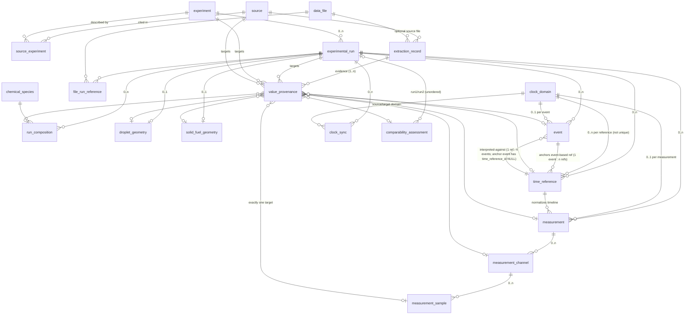

# combustion-research/schema

## Files

| File | Purpose |
| --- | --- |
| `v1.2.0.sql` (renamed from v1.2.0-candidate.sql) | Full DDL: 20 tables, composite FKs, CHECKs, triggers, unique index |
| `README.md` | This file: status, temporal-anchor contract, ERD, change notes |
| `validation-matrix.md` | **EXECUTED** 2026-11-12 on SQLite 3.54.1; rerun after D-1 fix: **112/112 MATCH** |

## Status

**v1.2.0 — promoted from v1.2.0-candidate by review decision. All 112 harness cases match.**

The harness `../tests/validate_schema_candidate.py` has been run twice against
this candidate (results: `../tests/schema_validation_results.md`):

- SQLite 3.54.1; 20/20 tables, 8/8 triggers, expression index present;
  `PRAGMA foreign_key_check` clean; `PRAGMA integrity_check` = `ok`; JSON1 available.
- **Run 1:** 111/112 MATCH — one defect (D-1): `comparability_assessment`
  accepted numeric run values with `comparison_unit = NULL`.
- **Run 2 (after the approved one-line D-1 correction):** **112/112 MATCH,
  0 mismatches.** The correction requires `comparison_unit` whenever any numeric
  comparison value is present; it changed no other behaviour (text-only
  `qualitatively_comparable`, numeric+unit+notes, and no-value
  `insufficient_information` all still behave as designed).

Promotion was approved after the post-D-1 rerun (112/112 MATCH, SQLite 3.54.1,
`foreign_key_check` clean, `integrity_check` = `ok`). Candidate history is preserved:
run 1 found defect D-1, the one-line correction is recorded in
`validation-matrix.md` §D-1, and both execution records are kept in
`../tests/schema_validation_results.md`.

## Insertion contract (temporal anchors)

Supported insertion order — plain immediate foreign keys, `PRAGMA
foreign_keys = ON` set outside any transaction:

```
experimental_run -> anchor event -> time_reference -> interpreted event
```

- **Anchor event** (e.g. run start, partial-gravity onset): `time_reference_id`
  is normally `NULL`. An anchor may, however, point at a *different* reference;
  it must never point at a reference that is anchored on itself.
- **`time_reference`** with `reference_kind = 'event'` is anchored on the anchor
  event via `reference_event_id` (composite FK on `(run_id, event_id)`).
- **Interpreted event** (e.g. ignition) or **measurement** points at that
  reference via `event.time_reference_id` / `measurement.time_reference_id`
  (composite FK on `(run_id, time_reference_id)`).

`PRAGMA defer_foreign_keys` is **not** part of the contract: the previous
version deferred constraint enforcement to permit a circular insert, but that
cycle only exists for the invalid "event anchors itself" case, which the four
self-anchor triggers now reject structurally. No supported use case requires
deferred foreign keys.

## Self-anchor guard triggers

Invariant per run: there is no pair (event E, time_reference R) where
`E.time_reference_id = R.time_reference_id` **and** `R.reference_event_id =
E.event_id`. Guarded on both sides (the invariant can be violated from either):

| Trigger | Fires | Blocks |
| --- | --- | --- |
| `trg_event_no_self_anchor_ins` | INSERT on `event` | Event pointing at a reference already anchored on itself |
| `trg_event_no_self_anchor_upd` | UPDATE on `event` | Setting `time_reference_id`, or changing `event_id`/`run_id` while a reference is set |
| `trg_time_reference_no_self_anchor_ins` | INSERT on `time_reference` | Anchoring on an event that already references this reference |
| `trg_time_reference_no_self_anchor_upd` | UPDATE on `time_reference` | Changing `reference_event_id`, `time_reference_id`, `run_id`, or `reference_kind` into a self-anchor |

Valid distinct-anchor use is never rejected: anchor `E1` (possibly pointing at
an unrelated reference `R0`), reference `R` anchored on `E1`, interpreted event
`E2` (`E2 <> E1`) using `R`. One anchor may anchor many references; one
reference may serve many interpreted events.

## ERD



Cardinality notes: `experiment → experimental_run` and `measurement →
measurement_channel` are `0..n` (the DDL enforces no minimum of one child);
`clock_domain → time_reference` is `0..n` (the FK is not unique on
`clock_domain_id`).

## Design principles preserved

1. **Three separable facts** — what the experiment measured
   (`measurement`/`measurement_sample`), what the source reported
   (`original_*` columns, `event_time_original`, `run_datetime_original`), and
   what the team inferred (`normalized_value`, `time_reference`,
   `comparability_assessment`) are stored as separate, separately attributable
   things. `value_provenance` links inferred facts back to their extraction
   evidence.
2. **No silent science** — clock offsets are recorded, never auto-applied;
   mole/mass fractions are stored independently with no auto conversion;
   duration is never derived by SQL arithmetic; timestamp ambiguity is
   preserved rather than resolved.
3. **Integrity without tautology** — every CHECK encodes a definitional or
   physical rule; no constraint merely restates column non-nullity.

## Change notes (v1.1.x -> v1.2.0, incl. the candidate period)

- Self-anchor guard triggers added; `defer_foreign_keys` contract removed.
- Timestamp model: `original_timestamp_parsed` is source-native (no epoch
  bound); `timestamp_epoch_utc` is normalized UTC and gated to convertible
  representations; `ambiguous` keeps source-native values but no epoch;
  `unknown_representation` preserves raw text.
- `quality_flag` CHECK corrected to `IS NULL OR IN (...)`.
- Unit requirement checks: pressure (incl. intervals/uncertainty),
  temperature, flow, geometry dimensions, fiber diameter.
- `clock_sync`: non-null `sync_segment_id` for multi-segment uniqueness;
  status semantics documented including `unknown`.
- `sampling_interval_s` standardized to seconds; `conversion_offset` requires
  `conversion_scale`.
- `comparability_assessment`: classification enum with evidence rules,
  unordered-pair unique index, `review_status` workflow.
- `value_provenance`: 12 explicit target columns, exactly-one target with
  `provenance_type`↔column matching, `curation_target_run_id` curation aid.

## Next milestone

1. Schema milestone complete: promoted to `v1.2.0` (approved). Renaming done;
   release tagging is left to the reviewer after final diff review.
2. Harness re-run command: `python3 tests/validate_schema_candidate.py`
   (from `combustion-research/`); results are written to
   `tests/schema_validation_results.md`.
3. After promotion, the next meaningful milestone is FLEX ingestion design
   against `v1.2.0`, starting with the documented temporal-anchor contract
   (`experimental_run -> anchor event -> time_reference -> interpreted event`).
